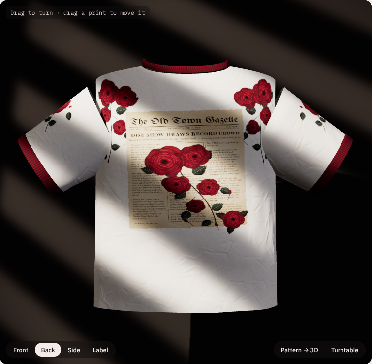
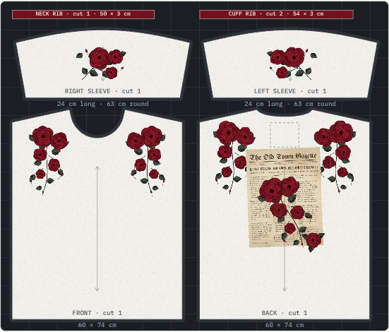
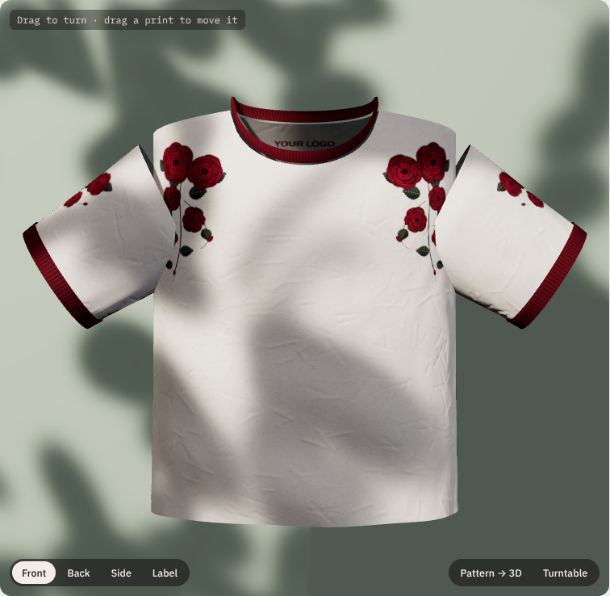

# Pattern Tee Studio

A browser tool for designing printed T-shirts on the real sewing pattern. Place artwork on the flat pattern pieces at real size, in centimetres, and see exactly where each print lands on a 3D tee.



## What it does

- **Pattern sheet at real size.** Front, back and two sleeves of an oversized tee (size L), drawn on a 10 cm grid, plus the neck rib and cuff rib strips. Drag, resize, rotate, mirror and duplicate prints. A badge shows each print's size in cm, and the readout gives its distance from the hem, the centre front or the shoulder seam.
- **Live 3D tee.** The same pattern is wrapped onto the 3D garment, so a print that crosses a seam is cut at the seam just as it would be in production. Drag the tee to turn it, or drag a print directly on the tee to move it.
- **Pattern → 3D animation.** The flat pieces fold up into the finished tee.
- **Ringer details.** Rib collar and cuffs in any colour, plus a printed neck label inside the back with your logo text, size, fibre content and care symbols.
- **Product photo setup.** Backdrop colours, and leaf-shadow, window-blind or soft studio lighting with an adjustable light direction.
- **Artwork.** Built-in rose, rose cascade, rose spray and vintage newspaper prints, text in three typefaces, or your own uploaded image.

The **Load rose ringer** preset recreates a white ringer tee with red roses cascading from the shoulders, a vintage gazette with a rose vine on the back, a deep red rib, and a red-ink neck label.

| Pattern sheet | Leaf light |
| --- | --- |
|  |  |

## Run it

It is a single static page with no build step. Open `index.html` in a browser, or serve the folder:

```sh
python3 -m http.server 8000
# then open http://localhost:8000
```

Three.js 0.160.0 loads from jsDelivr and the fonts load from Google Fonts, so the first load needs a network connection. Everything else runs locally in the browser. No artwork is uploaded anywhere.

## How it works

- All pattern pieces live in one 2048 × 2048 texture atlas at 15 px per cm. Prints are drawn into the atlas and clipped to the piece outlines.
- Each 3D panel is a grid generated from its pattern piece, so a vertex's texture coordinate is its position on the flat pattern. The body wraps around an elliptical cross-section that closes at the shoulder line. Sleeves are tapered elliptical tubes with a curved cap.
- Every vertex stores both its flat-layout position and its sewn position, and the assembly animation blends between the two.
- Fabric wrinkles come from a generated bump map, and the window and leaf shadows come from a spotlight with a projected texture that casts shadows.

## Garment measurements

| Piece | Size |
| --- | --- |
| Front / back | 60 × 74 cm flat, 9.5 cm neck half-width, 10 cm front neck drop, 2.5 cm back neck drop |
| Sleeve | 24 cm long, about 63 cm round at the cap, 4.5 cm cap height, drop shoulder |
| Neck rib | 50 × 3 cm |
| Cuff rib | 54 × 3 cm, cut 2 |
